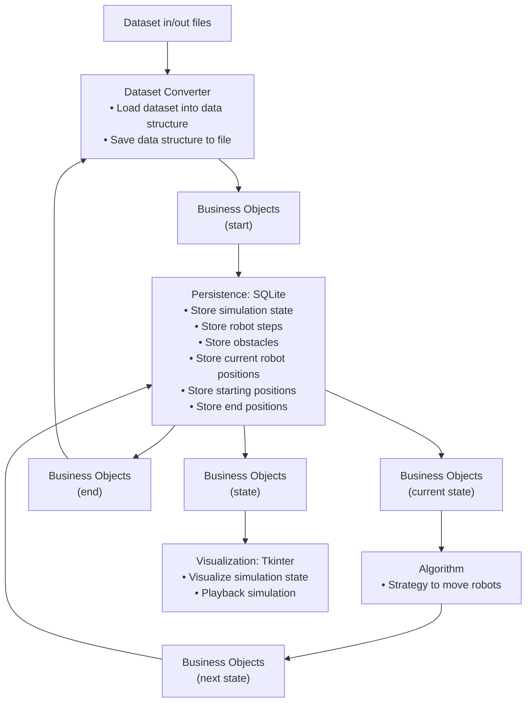

# Swisslog SDAO1 Coding Challenge. 

SwarmGridlock contains the challenge requirements and the initial files. 

SwarmManager is the project I built.

The core of the project is implemented in python.



I tried different strategies to move the robots:  
OR-Tools  
https://developers.google.com/optimization  
imported as a python project  
LaCAM  
https://github.com/Kei18/lacam  
compiled locally and invoked from python as an external process  
LaCAM3  
https://github.com/Kei18/lacam3
compiled locally and invoked from python as an external process  
# installation
I committed the alreay complied c++ sources.
I can you need to recompile them:  
Install mingw-w64 https://www.mingw-w64.org/  
on mingw-64 console

```
cmake -B build 
```

```
cmake --build build
```
collect dependencies with ldd command

```
$ ldd mapf.exe
        ntdll.dll => /c/WINDOWS/SYSTEM32/ntdll.dll (0x7ff9ba180000)
        KERNEL32.DLL => /c/WINDOWS/System32/KERNEL32.DLL (0x7ff9b87e0000)
        KERNELBASE.dll => /c/WINDOWS/System32/KERNELBASE.dll (0x7ff9b7830000)
        msvcrt.dll => /c/WINDOWS/System32/msvcrt.dll (0x7ff9b7f30000)
        libgcc_s_seh-1.dll => /mingw64/bin/libgcc_s_seh-1.dll (0x7ff9b31a0000)
        libstdc++-6.dll => /mingw64/bin/libstdc++-6.dll (0x7ff972d10000)
        libwinpthread-1.dll => /mingw64/bin/libwinpthread-1.dll (0x7ff9b3180000)
        libwinpthread-1.dll => /mingw64/bin/libwinpthread-1.dll (0x1dc59670000)

```
it may be necessary to adjust some classes to make it compile.  
I have not documented all the changes, but in my case where quite minimal.  
example:  
third_party/grid-pathfinding/graph/src/graph.cpp add in the include section  
```
#include <cstring>
```
# notes on the project structure
/db folder contains SQL lite db  
/files contains in and out files  
/lacam contains the exe files and DLL of the LaCAM project  
/pibt2 contains the exe files and DLL of pibt2 project  
/lacam3 contains the exe files and DLL for LaCAM3 project    
/src/swarmmanager contains the python implementation   
more important files:  
main.py launch the full pipeline, from file conversion to visualization  
main_visu_only.py launch only the visu, it's reading a SQL lite db file  
main_export_only.py launch only the export in to the .out format required by the coding challenge.  
planner to planner_v10 are various attempt to solve the problem  
bo.py business objects, used by all other components and persisted in SQL Lite tables ( Onion Architecture with ORM objects not separated from Business Objects)


